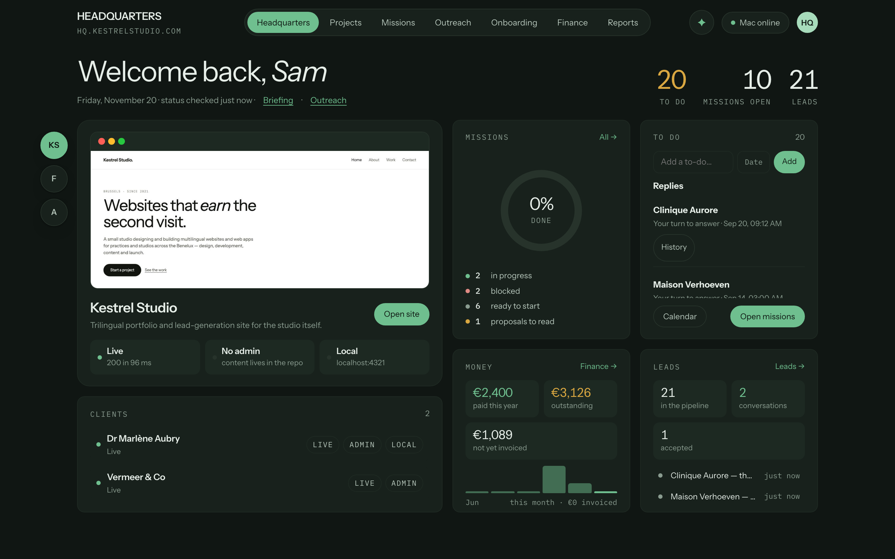
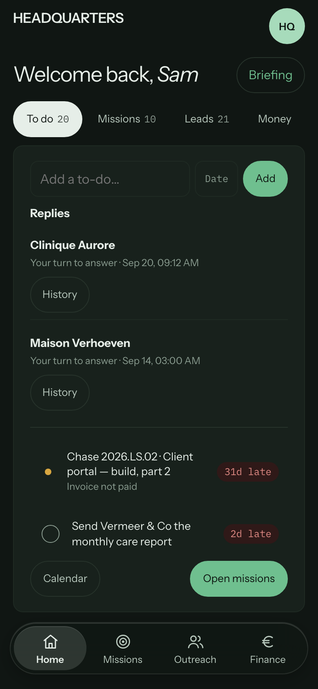
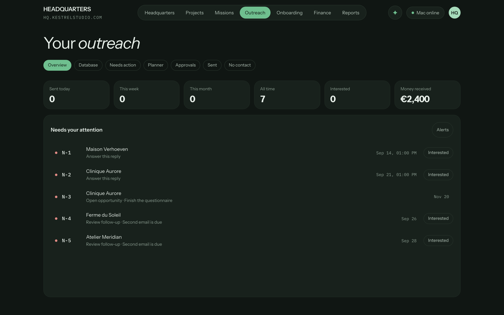
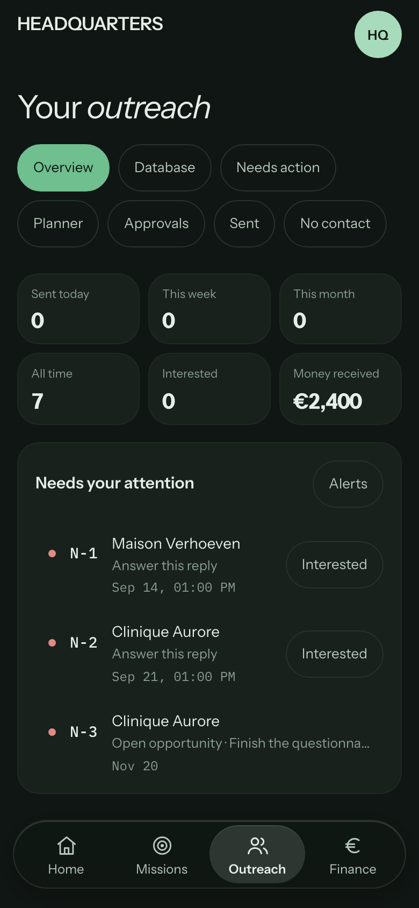
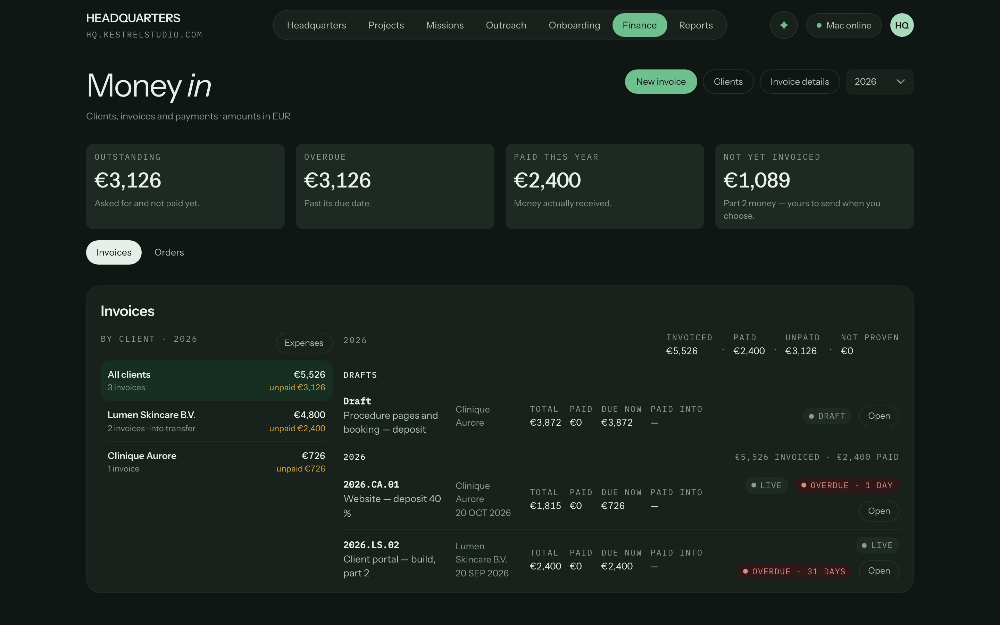

# Headquarters — a one-person studio's operating system

Headquarters (HQ) is the app a solo web studio runs its whole business from: leads and outreach, replies and whose turn it is, missions and to-dos, quotes, client onboarding, invoices and payments, and the studio's own websites, all in one place. It runs as one Cloudflare Worker with a D1 (SQLite) database, a hand-built front end with no framework, and a small local AI assistant on the Mac.

> A clean snapshot of a private repository, shared for review. Every name, client, invoice and lead you see is fictional demo data.

| Desktop | Phone |
|---|---|
|  |  |
|  |  |



## What it does
- **Outreach that respects people.** Lead lists in, letters written per sector and language (FR, NL, EN), daily draft batches that a human approves before anything is sent, delivery and bounce checks with a stop rule, suppression lists, and an honest « whose turn is it » for every conversation.
- **Needs your attention.** One list of what is waiting on you: replies to answer, follow-ups due, deals with a next step, invoices to chase. Every item has a short number that never changes (N-14), so you can say « 14 is done ».
- **Missions and to-dos**, proposed from replies and only real once accepted.
- **Onboarding.** A light questionnaire per prospect, a live mirror for the client, an approval flow, and « quote accepted » that turns a lead into a client, a project, an order and a deposit invoice in one step.
- **Finance.** Numbered invoices per series, deposits and balances, partial payments with undo, overdue chasing, issuer profiles, expenses, yearly views and print-ready PDFs.
- **The studio's own projects**, with live status probes, local dev links and one-click start of local services.
- **An assistant, on the Mac only.** Ask or tell HQ (« what do I have to do today? », « 3, 7 and 9 are done »). It runs through a closed list of tools, proposes every change and waits for a « Do it » click (with Undo), never sends, deletes, pays or approves anything, and keeps a hard monthly spending ceiling. Dictation is transcribed locally with whisper.cpp; nothing leaves the machine.

## Why it is built this way
- **One Worker, one database.** Cloudflare Workers + D1 keep hosting near zero and deploys to one command. Every schema change is an additive migration in `migrations/`.
- **No framework.** Plain ES modules and CSS: fast on a phone, nothing to upgrade, every screen readable in an afternoon.
- **Safety by construction.** Sending needs a human approval of the exact emails; writes to the database are validated first and written in a separate step; an intake door with its own tokens is the only way machines file data in; the assistant's model key lives only on the Mac.
- **Tested like a product.** About 1,700 unit and integration tests (vitest, with a real D1 engine via Miniflare), plus browser gates on a fictional demo: a visual sweep (overlaps, clipping, tiny type), phone-frame checks at 320–480 px, and axe accessibility checks (WCAG 2.0–2.2 A and AA).

## Stack
Cloudflare Workers · D1 (SQLite) · KV · vanilla JavaScript (ES modules) · CSS · vitest + Miniflare · Playwright · Anthropic Claude (assistant, Mac-only helper) · whisper.cpp (local dictation).

## Run it locally
You need Node 22 and npm.

```bash
npm install
npm run demo
```

`npm run demo` builds a throwaway local database from `migrations/` and `scripts/seed-demo.sql` (fictional data only) and serves it at **http://localhost:8790**. The demo signs you in by itself on localhost. Its own throwaway password is in `demo.vars`; it is not a secret.

```bash
npm test          # the full test suite
npm run gates     # the browser gates, against the demo
```

The demo never touches a real database: `wrangler.demo.jsonc` uses ids that exist nowhere, and the gates refuse to run against anything else.

### Deploying your own copy
`wrangler.jsonc` is the production config with every id replaced by `REPLACE_ME`. Create your own D1 database and KV namespaces (`wrangler d1 create`, `wrangler kv namespace create`), paste their ids and your account id, set a route, then `npm run release -- <commit>`.

The assistant (`assistant/`) runs only on your own machine. It reads a key file you create yourself, and the model key is never part of the Worker.

## What is not in this snapshot
- Real data of any kind: leads, clients, invoices, replies, archives, research and internal notes.
- The macOS app wrapper and the local mail bridge.
- Eight tests that check the owner's private project registry. They are kept and marked `skip` with the reason.

## License
All rights reserved — shared for review only.
